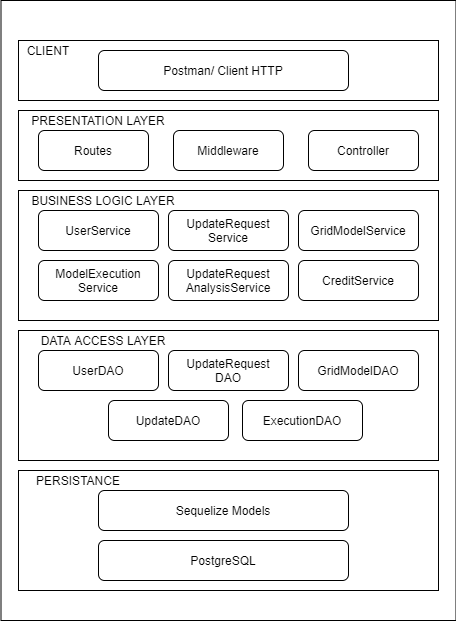
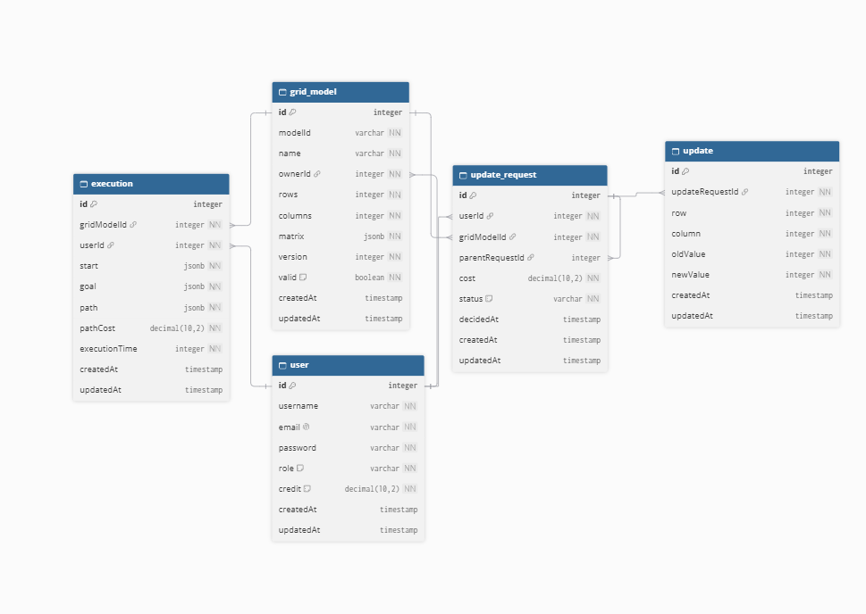
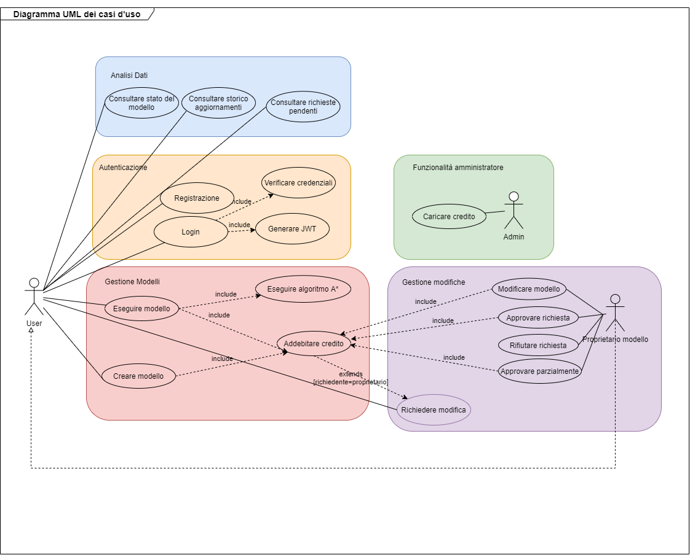
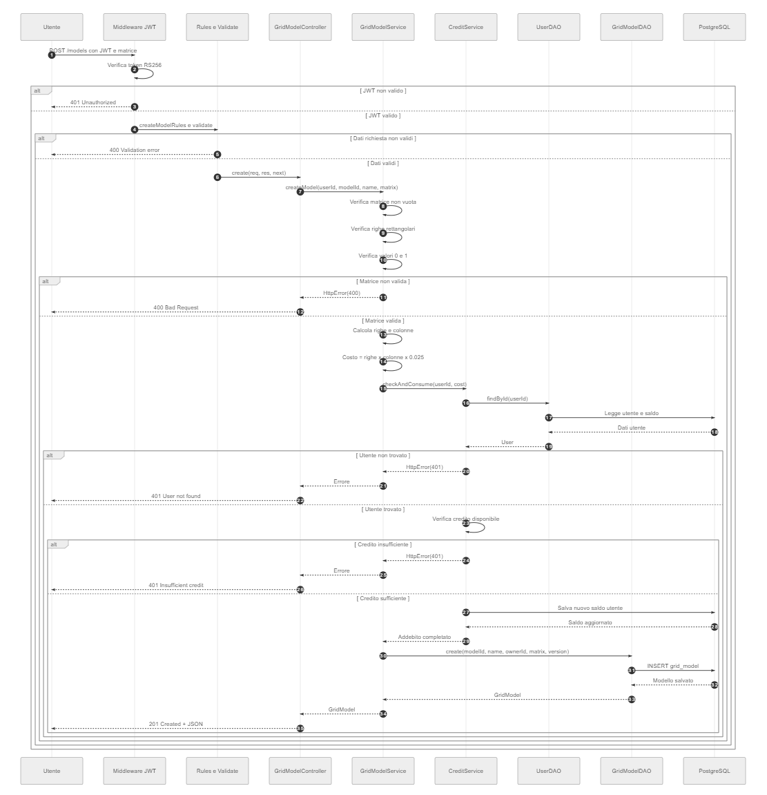
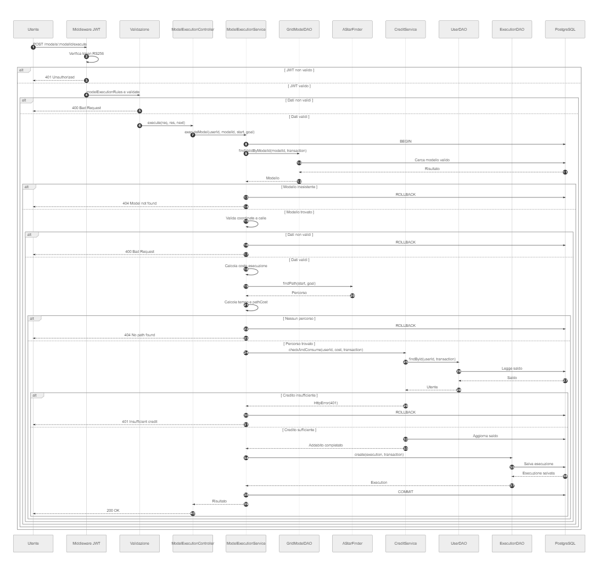
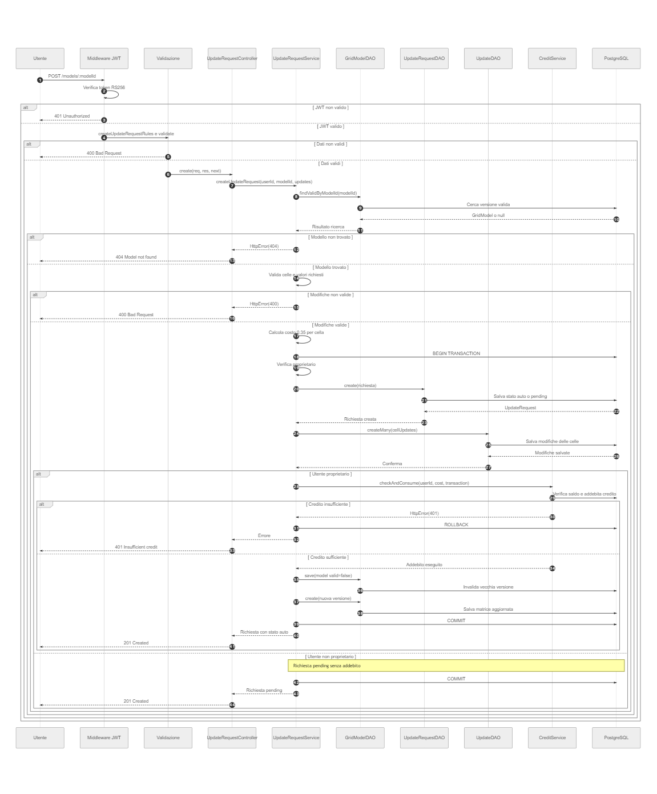
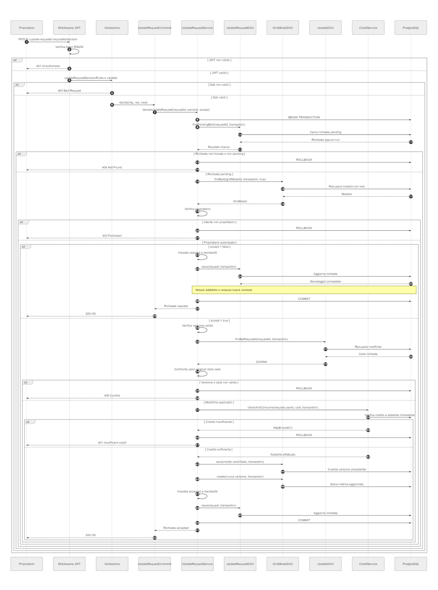
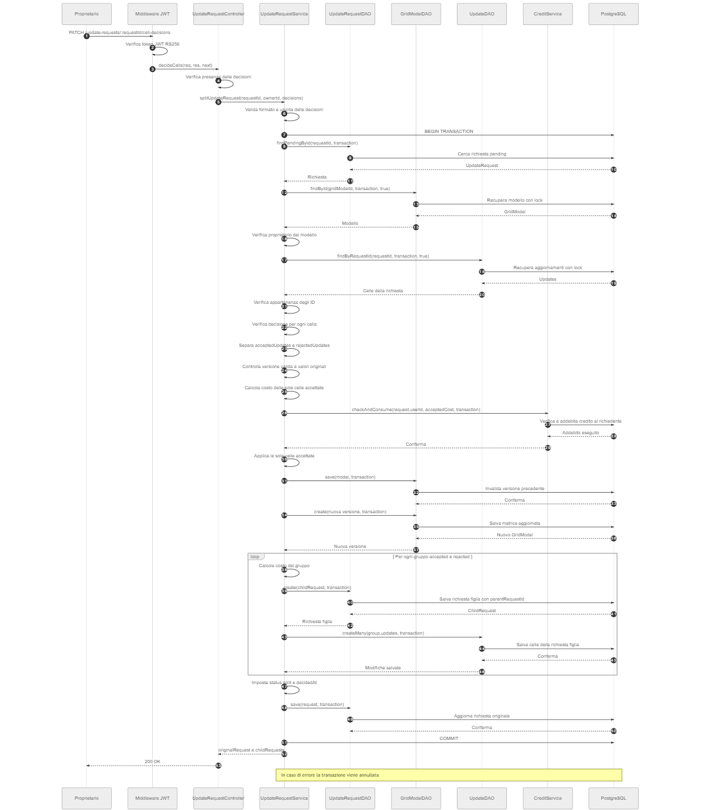
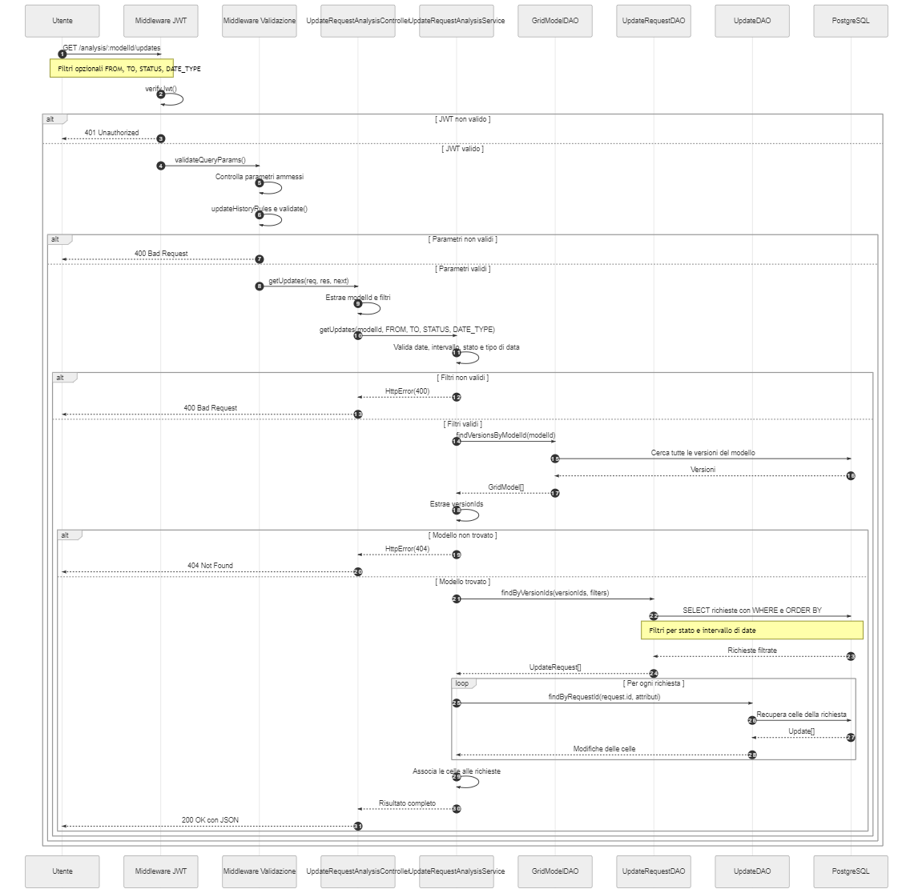

# Pathfinding API – Progetto di Programmazione Avanzata

**Autore:** Marta Marrazzo  
**Corso:** Programmazione Avanzata  
**Linguaggio:** TypeScript  
**Tipologia:** Backend REST API

## Indice

1. [Descrizione del progetto](#1-descrizione-del-progetto)
2. [Tecnologie utilizzate](#2-tecnologie-utilizzate)
3. [Architettura dell'applicazione](#3-architettura-dellapplicazione)
4. [Modello dei dati e diagramma ER](#4-modello-dei-dati-e-diagramma-er)
5. [Autenticazione e autorizzazione](#5-autenticazione-e-autorizzazione)
6. [Gestione dei modelli a griglia](#6-gestione-dei-modelli-a-griglia)
7. [Versionamento e richieste di aggiornamento](#7-versionamento-e-richieste-di-aggiornamento)
8. [Sistema di crediti](#8-sistema-di-crediti)
9. [Algoritmo di ricerca A*](#9-algoritmo-di-ricerca-a)
10. [Diagramma UML dei casi d’uso](#10-diagramma-uml-dei-casi-duso)
11. [Diagrammi UML di sequenza](#11-diagrammi-uml-di-sequenza)
12. [Design pattern utilizzati](#12-design-pattern-utilizzati)
13. [API REST principali](#13-api-rest-principali)
14. [Installazione e avvio con Docker](#14-installazione-e-avvio-con-docker)
15. [Dati dimostrativi](#15-dati-dimostrativi)
16. [Test automatici con Jest](#16-test-automatici-con-jest)
17. [Test delle API con Postman e Newman](#17-test-delle-api-con-postman-e-newman)
18. [Sicurezza e configurazione](#18-sicurezza-e-configurazione)
19. [Autore](#19-autore)

---

## 1. Descrizione del progetto

Pathfinding API è un'applicazione backend REST sviluppata in TypeScript per la gestione di modelli a griglia bidimensionale, il loro versionamento e l'esecuzione dell'algoritmo di ricerca del percorso A* (A-star).

Il sistema consente agli utenti autenticati di creare modelli, modificarne le celle, proporre aggiornamenti a modelli appartenenti ad altri utenti e gestire le relative richieste di approvazione.

L'applicazione comprende inoltre un sistema di crediti, funzionalità di analisi storica, controlli di autorizzazione e strumenti per l'esecuzione di test automatici.

Le principali funzionalità sono:

- Autenticazione tramite JWT con firma RS256.
- Gestione di utenti normali e amministratori.
- Creazione e validazione di modelli a griglia.
- Versionamento dei modelli.
- Aggiornamento diretto da parte del proprietario.
- Richieste di aggiornamento da parte di altri utenti.
- Approvazione, rigetto e accettazione parziale delle modifiche.
- Gestione dei crediti associati agli aggiornamenti.
- Consultazione dello storico con filtri temporali e per stato.
- Esecuzione dell'algoritmo A*.
- Persistenza dei dati su PostgreSQL.
- Test automatici con Jest e Postman/Newman.

---

## 2. Tecnologie utilizzate

| Tecnologia | Utilizzo |
|---|---|
| Node.js | Ambiente di esecuzione |
| TypeScript | Linguaggio di programmazione |
| Express.js | Realizzazione delle API REST |
| PostgreSQL 16 | Database relazionale |
| Sequelize | ORM per la gestione della persistenza |
| bcrypt | Gestione sicura delle password |
| JSON Web Token | Autenticazione tramite token |
| RS256 | Firma e verifica dei token con chiavi RSA |
| express-validator | Validazione delle richieste HTTP |
| astar-typescript | Implementazione dell'algoritmo A* |
| Docker | Containerizzazione |
| Docker Compose | Orchestrazione di backend e database |
| Jest | Test automatici |
| Postman | Test delle API REST |
| Newman | Esecuzione automatizzata della collection Postman |

---

## 3. Architettura dell'applicazione

L'applicazione adotta un'architettura a livelli, basata sulla separazione delle responsabilità tra gestione delle richieste HTTP, validazione dei dati, logica applicativa e persistenza.

La struttura del progetto è organizzata nei seguenti componenti:

- **Routes:** definiscono gli endpoint REST, associano i metodi HTTP alle operazioni disponibili e configurano la sequenza dei middleware e dei controller.
- **Middleware:** gestiscono funzionalità trasversali, tra cui la verifica dei token JWT, la validazione delle richieste e la gestione degli errori.
- **Rules di validazione:** definiscono i controlli sui dati in ingresso, verificando la presenza dei campi obbligatori, i tipi dei valori e il rispetto dei vincoli strutturali previsti. Sono implementate mediante `express-validator` e vengono eseguite prima del controller e della logica applicativa.
- **Controllers:** gestiscono le richieste HTTP, estraggono i parametri e i dati necessari, invocano i servizi applicativi e restituiscono le risposte al client.
- **Services:** implementano la logica di business del sistema, coordinando le operazioni relative alla creazione e al versionamento dei modelli, agli aggiornamenti delle matrici, alla gestione dei crediti e all'esecuzione dell'algoritmo A*.
- **DAO (Data Access Objects):** incapsulano le operazioni di accesso ai dati, separando, dove previsto, la logica applicativa dalle operazioni di persistenza.
- **Models:** definiscono le entità persistenti, i relativi attributi e le associazioni tra le entità mediante Sequelize.
- **Seed:** inizializza il database con dati predefiniti, quali utenti, modelli, versioni e richieste dimostrative, utili per verificare il funzionamento dell'applicazione e riprodurre gli scenari di test previsti.

### Diagramma dell'architettura
Il diagramma seguente illustra l'organizzazione dei componenti dell'applicazione.



### Flusso generale di una richiesta

Il flusso applicativo segue, in linea generale, questa sequenza:

**Client HTTP → Routes → Middleware di autenticazione JWT → Rules di validazione → Middleware `validate` → Controller → Service → DAO / Models → PostgreSQL**

La sequenza effettiva può variare in funzione dell'endpoint e delle operazioni richieste. Non tutte le richieste utilizzano necessariamente le stesse regole di validazione o passano attraverso un DAO.

Le routes definiscono il percorso della richiesta e l'ordine di esecuzione dei middleware. Il middleware di autenticazione verifica il token JWT, mentre le rules controllano la correttezza dei dati ricevuti. Il middleware `validate` raccoglie gli eventuali errori di validazione e impedisce alla richiesta di proseguire quando i dati non rispettano i vincoli previsti.

Se i controlli vengono superati, il controller gestisce la comunicazione HTTP e invoca il service corrispondente. Il service coordina la logica applicativa e, quando necessario, utilizza i DAO e i models per accedere ai dati persistenti nel database PostgreSQL.

Questa organizzazione favorisce la modularità, la manutenibilità, il riutilizzo del codice e la testabilità dei singoli componenti, rendendo più chiara la separazione delle responsabilità tra i diversi livelli applicativi.

---

## 4. Modello dei dati e diagramma ER



Il diagramma Entity-Relationship rappresenta la struttura del database relazionale PostgreSQL utilizzato dall'applicazione **Pathfinding API**.

La progettazione dei dati si basa su cinque entità principali, definite attraverso l'ORM Sequelize, collegate mediante chiavi primarie (PK) e chiavi esterne (FK).

**Entità principali**

- **User:** contiene le informazioni degli utenti registrati, comprese le credenziali di autenticazione, il ruolo applicativo e il credito disponibile.
- **GridModel:** rappresenta i modelli a griglia bidimensionale. Ogni record contiene la matrice, le dimensioni, il proprietario e il numero di versione. Il campo `modelId` identifica il modello logico, mentre la chiave primaria `id` distingue le singole versioni.
- **UpdateRequest:** registra le richieste di aggiornamento, memorizzando l'utente proponente, la versione del modello interessata, il costo, lo stato della richiesta e l'eventuale data della decisione.
- **Update:** rappresenta le singole modifiche alle celle associate a una richiesta, conservando le coordinate e i valori precedenti e successivi alla modifica.
- **Execution:** memorizza le esecuzioni dell'algoritmo A*, associandole all'utente e alla versione del modello utilizzata. Conserva le coordinate iniziali e finali, il percorso individuato, il costo del percorso e il tempo di esecuzione.

**Relazioni tra le entità**

Le relazioni sono prevalentemente di tipo uno-a-molti (1:N):

- Un utente può possedere più modelli, proporre più richieste di aggiornamento ed effettuare più esecuzioni.
- Una versione di un modello può essere associata a più richieste di aggiornamento e a più esecuzioni.
- Una richiesta di aggiornamento può contenere più modifiche alle singole celle.

È inoltre presente una **relazione ricorsiva sull'entità UpdateRequest**, realizzata tramite la chiave esterna opzionale `parentRequestId`. Questa permette di collegare una richiesta derivata alla richiesta originaria, supportando la tracciabilità delle operazioni di suddivisione (**split**).

**Scelte di persistenza**

Per rappresentare dati strutturati che non richiedono una suddivisione in ulteriori tabelle, viene utilizzato il tipo PostgreSQL `JSONB`. In particolare, questo tipo è impiegato per memorizzare la matrice bidimensionale dei modelli e le informazioni geometriche dei percorsi calcolati dall'algoritmo A*.

Gli importi economici, come il credito dell'utente e il costo delle richieste, sono rappresentati tramite `DECIMAL(10,2)`.

La presenza di campi `createdAt` e `updatedAt`, gestiti da Sequelize, consente di conservare informazioni temporali utili alla consultazione dello storico.

---

## 5. Autenticazione e autorizzazione

Il sistema utilizza JSON Web Token (JWT) per proteggere gli endpoint che richiedono autenticazione.

I token vengono firmati tramite algoritmo **RS256**, utilizzando una coppia di chiavi RSA:

- Chiave privata per la firma dei token.
- Chiave pubblica per la verifica dei token.

Le chiavi non vengono incluse nel repository e devono essere generate durante la configurazione dell'ambiente.

### Ruoli applicativi
**Utente normale**

Può creare modelli, eseguirli, proporre aggiornamenti e gestire le richieste relative ai modelli di cui è proprietario.

**Amministratore**

Può eseguire le funzionalità amministrative previste dall'applicazione, tra cui la ricarica del credito degli utenti.

Le decisioni sulle richieste di aggiornamento sono riservate al proprietario del modello interessato.

---

## 6. Gestione dei modelli a griglia

Ogni modello è identificato da un identificativo logico e contiene una matrice bidimensionale.

I valori della matrice descrivono la configurazione delle celle e vengono utilizzati anche per le operazioni di ricerca del percorso.

Il sistema esegue controlli sulla struttura e sui valori delle matrici, impedendo la creazione di modelli non validi.

Per gli aggiornamenti vengono inoltre verificate:

- La validità delle coordinate.
- L'appartenenza delle coordinate alla griglia.
- La correttezza dei nuovi valori.
- L'assenza di modifiche duplicate nella stessa richiesta.
- La differenza tra il valore corrente della cella e quello proposto.

Il sistema conserva le versioni dei modelli per consentire la consultazione delle modifiche effettuate nel tempo.

---

## 7. Versionamento e richieste di aggiornamento

La gestione degli aggiornamenti dipende dalla proprietà del modello.

### Aggiornamento diretto del proprietario
Quando il proprietario modifica un proprio modello, l'aggiornamento viene applicato direttamente, dopo la verifica dei vincoli applicativi e del credito disponibile.

### Richiesta di aggiornamento di un altro utente
Quando un utente diverso dal proprietario propone una modifica, viene creata una richiesta con stato iniziale `pending`.

Il proprietario del modello può successivamente esaminare la richiesta e decidere se accettarla o respingerla.

### Approvazione, rigetto e split
Sono previste tre modalità di gestione:

- **Approvazione completa:** vengono accettate tutte le modifiche richieste.
- **Rigetto completo:** vengono respinte tutte le modifiche richieste.
- **Split:** il proprietario decide individualmente quali modifiche accettare e quali respingere.

Le richieste e le decisioni vengono registrate per consentire la successiva consultazione dello storico.

---

## 8. Sistema di crediti

Il sistema associa un saldo di crediti a ciascun utente.

Il costo previsto per gli aggiornamenti è pari a **0,35 crediti per cella accettata**.

La gestione del credito segue queste regole:

- Gli aggiornamenti diretti del proprietario comportano un addebito immediato.
- Gli utenti non proprietari possono proporre modifiche anche se non dispongono di credito.
- Per le modifiche proposte, il credito viene controllato e addebitato al momento dell'approvazione.
- Le modifiche respinte non comportano un addebito.
- In caso di credito insufficiente, l'operazione che richiede l'addebito non viene completata.
- La ricarica dei crediti è riservata agli amministratori.

L'addebito differito delle modifiche proposte rappresenta una scelta progettuale adottata nell'implementazione: l'utente sostiene il costo quando la modifica viene effettivamente accettata.

---

## 9. Algoritmo di ricerca A*

L'applicazione integra l'algoritmo di ricerca del percorso **A-star (A*)** mediante la libreria `astar-typescript`.

Per avviare un'esecuzione, l'utente specifica:

- La posizione iniziale.
- La posizione di destinazione.
- Il modello sul quale effettuare la ricerca.

Il sistema verifica che le coordinate appartengano alla griglia e che le posizioni siano valide.

Se esiste un percorso raggiungibile, l'applicazione restituisce i dati dell'esecuzione, comprendenti il percorso individuato, il costo e il tempo di elaborazione.

Sono gestiti anche i casi in cui:

- Le coordinate non sono valide.
- Una posizione richiesta è un ostacolo.
- Non esiste un percorso tra partenza e destinazione.

Le informazioni relative alle esecuzioni vengono gestite dal servizio applicativo e possono essere registrate nel database.

---

## 10. Diagramma UML dei casi d’uso



Il diagramma UML dei casi d'uso rappresenta le principali funzionalità della **Pathfinding API**, evidenziando le interazioni tra gli attori e il sistema, le operazioni disponibili e le dipendenze tra i diversi casi d'uso.

Il diagramma è organizzato in cinque aree funzionali: **Analisi dati, Autenticazione, Gestione modelli, Gestione modifiche e Funzionalità amministratore**.

### Attori del sistema
Sono rappresentati tre attori principali:

- **User:** rappresenta l'utente che può registrarsi, autenticarsi, creare ed eseguire modelli, proporre modifiche e consultare le informazioni sui modelli e sugli aggiornamenti.
- **Proprietario del modello:** rappresenta una specializzazione dell'utente, autorizzata a modificare direttamente i propri modelli e a decidere sulle richieste di modifica ricevute.
- **Admin:** rappresenta l'amministratore del sistema, autorizzato a effettuare operazioni di ricarica del credito degli utenti.

La relazione di generalizzazione tra **Proprietario del modello** e **User** indica che il proprietario eredita le funzionalità dell'utente, disponendo inoltre delle operazioni riservate alla proprietà del modello.

### Autenticazione
L'area di autenticazione comprende la registrazione e il login.

Il caso d'uso **Login** include la verifica delle credenziali dell'utente e la generazione di un token JWT, utilizzato successivamente per autenticare le richieste alle API protette.

Le relazioni `«include»` indicano che queste operazioni costituiscono passaggi necessari al completamento del login.

### Gestione dei modelli
L'utente può creare nuovi modelli a griglia ed eseguire i modelli esistenti.

Il caso d'uso **Eseguire modello** include l'utilizzo dell'algoritmo A*, implementato attraverso la libreria `astar-typescript`, per individuare un percorso tra le coordinate iniziali e finali all'interno della matrice.

La creazione e l'esecuzione dei modelli comprendono inoltre la gestione dell'addebito dei crediti, il cui importo viene calcolato in funzione delle dimensioni della griglia.

### Gestione delle modifiche
Il sistema permette agli utenti di richiedere modifiche alle celle dei modelli.

Il proprietario può modificare direttamente il proprio modello oppure gestire le richieste ricevute attraverso tre operazioni:

- **Approvare richiesta:** accetta le modifiche proposte e ne applica il relativo costo al credito del richiedente.
- **Rifiutare richiesta:** respinge le modifiche senza effettuare addebiti.
- **Approvare parzialmente:** consente di accettare soltanto alcune modifiche, addebitando esclusivamente il costo delle celle accettate.

Il diagramma utilizza la relazione `«extend»` per rappresentare l'addebito condizionale associato alla richiesta di modifica: quando il richiedente è anche proprietario del modello, la modifica viene applicata direttamente con addebito immediato. Negli altri casi, la richiesta rimane in attesa della decisione del proprietario.

### Analisi dei dati
Il sistema mette a disposizione funzionalità di consultazione per:

- Verificare lo stato di un modello.
- Consultare lo storico degli aggiornamenti.
- Visualizzare le richieste di modifica pendenti.

Queste operazioni consentono di monitorare lo stato delle richieste e ricostruire l'evoluzione dei modelli nel tempo.

### Funzionalità amministrative
L'amministratore può effettuare la **ricarica del credito** degli utenti, necessaria per consentire l'esecuzione delle operazioni soggette a pagamento.

L'accesso alla funzionalità è riservato agli utenti con ruolo amministrativo mediante i controlli di autenticazione e autorizzazione implementati nel backend.

### Relazioni tra i casi d'uso
Nel diagramma sono utilizzate le principali relazioni UML:

- **Associazione:** collega gli attori alle funzionalità con cui interagiscono.
- **`«include»`:** rappresenta comportamenti richiamati nell'esecuzione di un caso d'uso principale, come l'utilizzo dell'algoritmo A* e la gestione degli addebiti.
- **`«extend»`:** rappresenta un comportamento aggiuntivo eseguito al verificarsi di una specifica condizione, come l'addebito immediato per una modifica richiesta dal proprietario.
- **Generalizzazione:** rappresenta la specializzazione dell'attore **Proprietario del modello** rispetto all'attore **User**.

Nel complesso, il diagramma evidenzia la separazione delle responsabilità tra utenti, proprietari e amministratori, oltre all'integrazione tra autenticazione JWT, gestione dei modelli, algoritmo A*, sistema dei crediti e approvazione delle modifiche.

---

## 11. Diagrammi UML di sequenza

I diagrammi seguenti descrivono i principali flussi applicativi, dalla creazione del modello all’analisi dello storico delle modifiche.

### Creazione del modello



Il diagramma rappresenta il processo di creazione di un nuovo modello a griglia attraverso l'endpoint `POST /models`, evidenziando le interazioni tra middleware, Controller, Service, DAO e database PostgreSQL.

La richiesta viene inizialmente autenticata tramite il middleware `verifyJwt`, che verifica il token JWT utilizzando l'algoritmo RS256. Successivamente, `createModelRules` e `validate` verificano la correttezza dei dati ricevuti.

Il `GridModelController` delega quindi l'operazione al `GridModelService`, che esegue ulteriori controlli sulla struttura della matrice, verificando che non sia vuota, che le righe abbiano lunghezza uniforme e che i valori siano esclusivamente `0` e `1`.

Superata la validazione, il Service determina le dimensioni della matrice e calcola il costo economico della creazione, pari a **0,025 crediti per cella**.

Il `CreditService` verifica la disponibilità del credito dell'utente e procede all'addebito. In caso di saldo insufficiente, l'operazione viene interrotta e viene restituito un errore HTTP.

Se l'addebito viene completato, `GridModelDAO` salva il nuovo modello nel database PostgreSQL, associandolo all'utente proprietario e assegnandogli la versione iniziale `1`, con stato `valid = true`.

Il diagramma rappresenta anche i principali flussi alternativi, tra cui autenticazione non valida, dati non conformi e credito insufficiente.

In caso di successo, il Controller restituisce la risposta HTTP `201 Created`, contenente il modello appena creato.

L'operazione, nella versione attuale del servizio, non prevede una transazione esplicita che comprenda sia l'addebito sia il salvataggio del modello.

### Esecuzione dell’algoritmo A*



Il diagramma di sequenza rappresenta il processo di esecuzione di un modello a griglia mediante l'algoritmo **A-star (A*)**, attraverso l'endpoint `POST /models/:modelId/execute`.

Il diagramma evidenzia le interazioni tra i diversi componenti dell'architettura, mostrando la separazione delle responsabilità tra middleware, Controller, Service, DAO e database PostgreSQL.

**Flusso di esecuzione**

1. **Autenticazione e validazione:** l'utente invia la richiesta specificando il modello, le coordinate iniziali e quelle di destinazione. Il middleware `verifyJwt` verifica il token JWT mediante l'algoritmo RS256, mentre `modelExecutionRules` e `validate` controllano i dati ricevuti.
2. **Gestione della richiesta:** il `ModelExecutionController` riceve la richiesta validata e delega l'operazione al metodo `executeModel()` del `ModelExecutionService`.
3. **Recupero del modello:** il Service avvia una transazione Sequelize e utilizza `GridModelDAO` per recuperare la versione valida del modello. Verifica inoltre che le coordinate appartengano alla griglia e che le celle iniziale e finale siano percorribili.
4. **Esecuzione dell'algoritmo A*:** attraverso la libreria `astar-typescript`, il sistema ricerca un percorso tra le coordinate indicate, senza consentire movimenti diagonali. Vengono calcolati il percorso, il relativo costo in numero di movimenti e il tempo impiegato dall'algoritmo.
5. **Gestione dei crediti:** se viene individuato un percorso, il sistema calcola il costo economico dell'esecuzione, pari a **0,025 crediti per cella della griglia**. Il `CreditService` verifica la disponibilità del saldo tramite `UserDAO` ed effettua l'addebito.
6. **Persistenza del risultato:** il `ModelExecutionService` utilizza `ExecutionDAO` per salvare l'esecuzione nel database, registrando il modello utilizzato, l'utente, le coordinate, il percorso, il costo e il tempo di esecuzione.
7. **Conclusione:** la transazione viene confermata mediante `commit()` e il Controller restituisce una risposta HTTP `200 OK` contenente il risultato dell'esecuzione.

**Gestione degli errori e transazioni**

Il diagramma rappresenta anche i principali flussi alternativi: token non valido, parametri errati, modello inesistente, coordinate non valide, percorso non disponibile e credito insufficiente.

Le operazioni sul credito e il salvataggio dell'esecuzione vengono eseguiti all'interno della stessa transazione Sequelize. In presenza di un errore viene effettuato il `rollback()`, evitando che un'esecuzione non completata produca un addebito definitivo.

Gli errori sono propagati dal Controller al middleware centralizzato `errorHandler`, responsabile della restituzione delle corrispondenti risposte HTTP.

Questo diagramma evidenzia l'integrazione tra **algoritmo A*, gestione dei crediti, persistenza dei risultati e controllo transazionale**, oltre alla separazione delle responsabilità prevista dall'architettura applicativa.

### Gestione delle richieste di modifica

I seguenti diagrammi descrivono le interazioni tra i componenti dell'applicazione durante la creazione, l'approvazione, il rifiuto e la gestione parziale delle richieste di aggiornamento delle celle di un modello.

I diagrammi evidenziano la separazione delle responsabilità tra Controller, Service e DAO, il controllo delle autorizzazioni, la gestione dei crediti e il versionamento dei modelli, attraverso operazioni eseguite all'interno di transazioni Sequelize.

### Creazione della richiesta di modifica


Il diagramma rappresenta il processo di creazione di una richiesta di modifica attraverso l'endpoint `POST /models/:modelId`.

Dopo l'autenticazione tramite JWT e la validazione dei dati, `UpdateRequestController` delega l'operazione a `UpdateRequestService`, che recupera la versione valida del modello, verifica le coordinate e i valori delle celle e calcola il costo di **0,35 crediti per cella**.

Il comportamento dipende dalla proprietà del modello:

- **Proprietario:** la richiesta viene registrata con stato `auto`, il credito viene addebitato immediatamente e le modifiche vengono applicate creando una nuova versione del modello.
- **Utente non proprietario:** la richiesta viene registrata con stato `pending`, senza addebiti e senza modificare la matrice, in attesa della decisione del proprietario.

Le richieste e le modifiche vengono salvate tramite `UpdateRequestDAO` e `UpdateDAO`. Le operazioni di persistenza e, nel caso del proprietario, di addebito e versionamento sono gestite mediante una transazione Sequelize, garantendo l'annullamento delle modifiche in caso di errore.

### Approvazione o rifiuto della richiesta


Il diagramma descrive il processo decisionale attraverso l'endpoint `PATCH /update-requests/:requestId/decision`.

Il `UpdateRequestController` invoca il metodo `decideUpdateRequest()` del `UpdateRequestService`, che recupera la richiesta, verifica che sia nello stato `pending` e controlla che l'utente autenticato sia il proprietario del modello associato.

La decisione determina due possibili comportamenti:

- **Rifiuto:** la richiesta assume lo stato `rejected` e viene registrata la data della decisione, senza addebiti né modifiche al modello.
- **Approvazione:** il sistema verifica che la versione del modello sia ancora valida e che i valori originali delle celle siano invariati. Successivamente, tramite `CreditService`, addebita il costo al richiedente, invalida la precedente versione del modello e ne crea una nuova contenente le modifiche approvate. La richiesta assume lo stato `accepted`.

L'aggiornamento dello stato viene effettuato attraverso `UpdateRequestDAO`. L'intero processo decisionale è gestito all'interno di una transazione, che assicura il rollback in caso di errore e impedisce l'applicazione parziale delle operazioni.

### Approvazione parziale della richiesta (Split)


Il diagramma rappresenta il processo di approvazione parziale delle modifiche attraverso l'endpoint `PATCH /update-requests/:requestId/cell-decisions`.

La funzionalità consente al proprietario di accettare alcune modifiche e rifiutarne altre all'interno della stessa richiesta.

Il `UpdateRequestController` delega il processo di approvazione parziale al metodo `splitUpdateRequest()` del `UpdateRequestService`, che verifica lo stato della richiesta, la proprietà del modello e la validità delle decisioni, assicurando che ogni cella abbia ricevuto una decisione.

Le modifiche vengono suddivise in due gruppi, `acceptedUpdates` e `rejectedUpdates`.

Soltanto le celle accettate vengono applicate alla matrice, dopo la verifica della validità del modello e dei valori originali. Il costo, pari a **0,35 crediti per cella accettata**, viene addebitato al richiedente tramite `CreditService`. Il sistema genera quindi una nuova versione del modello, mentre le celle rifiutate non vengono applicate e non comportano addebiti.

Per conservare lo storico delle decisioni, vengono create due richieste figlie con stato `accepted` e `rejected`, collegate alla richiesta originale attraverso `parentRequestId`. Le richieste figlie vengono registrate tramite `UpdateRequestDAO`, mentre le relative modifiche sono salvate mediante `UpdateDAO`.

La richiesta originale assume infine lo stato `split`.

s

Tutte le operazioni di addebito, aggiornamento del modello e persistenza vengono eseguite all'interno di un'unica transazione Sequelize, garantendo la consistenza dei dati anche in caso di errore.

### Diagramma UML di sequenza – Analisi delle richieste di modifica con filtri


Il diagramma rappresenta il processo di consultazione dello storico delle richieste di modifica di un modello attraverso l'endpoint `GET /analysis/:modelId/updates`.

La richiesta viene inizialmente sottoposta all'autenticazione tramite JWT e alla validazione dei parametri mediante i middleware `validateQueryParams`, `updateHistoryRules` e `validate`.

Il sistema permette di applicare filtri opzionali per intervallo temporale (`FROM` e `TO`), stato della richiesta (`STATUS`) e tipo di data (`DATE_TYPE`), distinguendo tra data di creazione (`createdAt`) e data di aggiornamento (`updatedAt`).

Il `UpdateRequestAnalysisController` estrae i parametri ricevuti e delega l'operazione al metodo `getUpdates()` del `UpdateRequestAnalysisService`, che verifica la correttezza dei filtri e recupera, tramite `GridModelDAO`, tutte le versioni associate al modello richiesto.

Successivamente, `UpdateRequestDAO` ricerca le richieste di modifica relative alle versioni individuate, applicando i filtri mediante Sequelize e ordinando i risultati in ordine cronologico decrescente rispetto al tipo di data selezionato.

Per ciascuna richiesta, il Service utilizza `UpdateDAO` per recuperare le modifiche delle singole celle, includendo le coordinate, il valore originale e quello nuovo. Le operazioni di recupero vengono gestite tramite `Promise.all()`.

Il risultato viene restituito dal Controller in formato JSON con codice HTTP `200 OK`, contenente le richieste filtrate e le rispettive modifiche.

Il diagramma evidenzia la **separazione tra validazione, logica applicativa e accesso ai dati**, oltre alla possibilità di consultare lo storico completo delle modifiche attraverso tutte le versioni di uno stesso modello.

---

## 12. Design pattern utilizzati

Nel progetto **Pathfinding API** sono stati applicati due pattern principali: **Data Access Object (DAO)** e **Chain of Responsibility**.

Il primo consente di separare la logica applicativa dalle operazioni di persistenza, mentre il secondo permette di organizzare l'elaborazione delle richieste HTTP attraverso una sequenza di middleware specializzati.

### Data Access Object (DAO)
Il **Data Access Object (DAO)** è un pattern che introduce un'astrazione tra la logica applicativa e il sistema di persistenza, nascondendo i dettagli delle operazioni di accesso ai dati.

Il suo utilizzo permette di evitare che le classi responsabili della logica di business debbano implementare direttamente le interrogazioni al database.

Nella Pathfinding API il pattern è applicato attraverso classi DAO che utilizzano Sequelize per comunicare con PostgreSQL, tra cui `GridModelDAO`, `UpdateRequestDAO` e `UpdateDAO`.

**Esempio di applicazione**

Consideriamo la funzionalità di consultazione dello storico delle richieste di modifica di un modello, che permette di applicare filtri per data e stato.

Nel metodo `getUpdates()` di `UpdateRequestAnalysisService`, il recupero delle richieste viene delegato a `UpdateRequestDAO`:

```typescript
const requests = await this.updateRequestDAO.findByVersionIds(
    versionIds,
    {
        fromDate,
        toDate,
        dateType: DATE_TYPE,
        status: STATUS
    }
);
```

Il metodo `findByVersionIds()` del DAO costruisce le condizioni di ricerca utilizzando gli operatori di Sequelize e interroga il database attraverso:

```typescript
return UpdateRequest.findAll({
    where,
    order: [[filters.dateType ?? 'createdAt', 'DESC']]
});
```

In questo esempio è possibile riconoscere il pattern DAO poiché il Service specifica **quali informazioni devono essere recuperate**, mentre il DAO si occupa di **come recuperarle dal database**.

Il Service non deve quindi conoscere la struttura della query o le modalità con cui Sequelize esegue l'interrogazione.

Il pattern permette di centralizzare le operazioni di persistenza, ridurre la duplicazione del codice e limitare l'accoppiamento tra la logica applicativa e il sistema di accesso ai dati.

### Chain of Responsibility
Il **Chain of Responsibility** è un design pattern comportamentale della **Gang of Four** che permette di distribuire l'elaborazione di una richiesta tra più componenti collegati in sequenza.

Ogni componente ha una responsabilità specifica e può consentire il proseguimento dell'elaborazione oppure interrompere il flusso.

Nella Pathfinding API questo principio viene applicato attraverso i middleware di Express, utilizzati per gestire autenticazione, controllo dei parametri, validazione e propagazione degli errori.

**Esempio di applicazione**

Consideriamo la richiesta HTTP utilizzata per consultare esclusivamente le richieste di modifica approvate:

```http
GET /analysis/:modelId/updates?STATUS=accepted
```

La relativa rotta Express è definita nel seguente modo:

```typescript
router.get(
    '/analysis/:modelId/updates',
    verifyJwt,
    validateQueryParams([
        'FROM',
        'TO',
        'STATUS',
        'DATE_TYPE'
    ]),
    updateHistoryRules,
    validate,
    (req, res, next) =>
        updateRequestAnalysisController.getUpdates(
            req,
            res,
            next
        )
);
```

La richiesta attraversa una sequenza di componenti, ciascuno caratterizzato da una responsabilità specifica:

1. **`verifyJwt`** verifica il token JWT dell'utente e consente di proseguire soltanto se l'autenticazione è valida.
2. **`validateQueryParams`** controlla che i parametri della query siano tra quelli consentiti dall'endpoint.
3. **`updateHistoryRules`** definisce le regole di validazione, verificando che il parametro `STATUS` contenga uno dei valori ammessi: `accepted`, `rejected`, `pending`, `auto` o `split`.
4. **`validate`** controlla i risultati delle validazioni e, in presenza di errori, ne interrompe la normale elaborazione.
5. **`UpdateRequestAnalysisController`** riceve la richiesta dopo il superamento dei controlli e invoca il Service responsabile della consultazione dello storico.

Se il token JWT è valido e il parametro `STATUS` contiene il valore `accepted`, la richiesta raggiunge il Controller e viene elaborata.

Se invece viene utilizzato un valore non consentito, ad esempio `STATUS=unknown`, la validazione rileva l'errore e lo propaga attraverso `next(error)` al middleware centralizzato `errorHandler`, che restituisce una risposta HTTP `400 Bad Request`.

In questo esempio il Chain of Responsibility è riconoscibile perché l'elaborazione non è affidata a un unico componente, ma viene distribuita tra più middleware, ognuno dei quali svolge un controllo specifico prima di consentire il passaggio al successivo.

L'utilizzo del pattern favorisce il riutilizzo dei middleware, la separazione delle responsabilità e la gestione uniforme degli errori, evitando di ripetere gli stessi controlli all'interno dei Controller.

### Considerazioni finali
I due pattern affrontano problemi progettuali differenti.

Il **DAO** consente di isolare le operazioni di accesso al database dalla logica applicativa, mentre il **Chain of Responsibility** permette di organizzare l'elaborazione delle richieste HTTP mediante componenti successivi con responsabilità distinte.

La loro applicazione contribuisce a rendere la Pathfinding API più modulare, manutenibile e facilmente estendibile.

---

## 13. API REST principali

Con la configurazione Docker predefinita, le API sono accessibili all'indirizzo:

`http://localhost:3000`

| Metodo | Endpoint | Descrizione |
|---|---|---|
| GET | `/health` | Verifica dello stato del backend |
| POST | `/login` | Autenticazione dell'utente |
| POST | `/models` | Creazione di un nuovo modello |
| POST | `/models/:modelId` | Aggiornamento o proposta di modifica |
| PATCH | `/update-requests/:requestId/decision` | Approvazione o rigetto completo |
| PATCH | `/update-requests/:requestId/cell-decisions` | Decisioni sulle singole modifiche |
| GET | `/analysis/:modelId/updates` | Consultazione degli aggiornamenti |
| GET | `/analysis/:modelId/status` | Stato delle richieste del modello |
| GET | `/analysis/pending-requests` | Richieste in attesa sui propri modelli |
| POST | `/models/:modelId/execute` | Esecuzione dell'algoritmo A* |
| PATCH | `/users/credit` | Ricarica amministrativa del credito |

Gli endpoint protetti richiedono il token JWT nell'header HTTP:

`Authorization: Bearer <token>`

### Esempio di creazione di un modello

**POST `/models`**

```json
{
  "modelId": "example-grid",
  "name": "Example Grid",
  "matrix": [
    [0, 0, 0],
    [0, 1, 0],
    [0, 0, 0]
  ]
}
```

### Esempio di proposta di aggiornamento

**POST `/models/example-grid`**

```json
[
  {
    "row": 0,
    "column": 1,
    "newValue": 1
  }
]
```

### Esempio di approvazione completa

**PATCH `/update-requests/:requestId/decision`**

```json
{
  "accept": true
}
```

### Esempio di esecuzione A*

**POST `/models/astar-demo/execute`**

```json
{
  "start": {
    "row": 0,
    "column": 0
  },
  "goal": {
    "row": 2,
    "column": 2
  }
}
```

---

## 14. Installazione e avvio con Docker

Il progetto utilizza Docker Compose per avviare il backend Node.js/Express e il database PostgreSQL 16.

### Prerequisiti
Per avviare il progetto sono necessari:

- Git.
- Docker Desktop o Docker Engine con Docker Compose.
- OpenSSL per generare le chiavi RSA.

Per eseguire i test Jest e Newman direttamente sulla macchina locale è necessario anche Node.js con npm.

### Clonazione del repository
```bash
git clone https://github.com/mmarrazzo00/programmazione-avanzata-marta-marrazzo.git
cd programmazione-avanzata-marta-marrazzo
```

### Configurazione delle variabili d'ambiente
Il progetto utilizza un file `.env` per configurare l'ambiente locale.

Il file `.env` non viene incluso nel repository per evitare la pubblicazione di credenziali.

Per configurare l'applicazione, copiare il file  `.env.example`, fornito nel repository, e rinominare la copia in `.env`.

Su Windows PowerShell:

```powershell
Copy-Item .env.example .env
```

Su Linux o macOS:

```bash
cp .env.example .env
```

Le principali variabili utilizzate da Docker Compose sono:

| Variabile | Descrizione |
|---|---|
| `DB_NAME` | Nome del database PostgreSQL |
| `DB_USER` | Utente PostgreSQL |
| `DB_PASS` | Password PostgreSQL |
| `DB_PORT` | Porta PostgreSQL sull'host, predefinita `5432` |
| `APP_PORT` | Porta HTTP sull'host, predefinita `3000` |

Esempio di configurazione locale:

```dotenv
DB_NAME=taskdb
DB_USER=postgres
DB_PASS=change_me_for_local_demo
DB_PORT=5432
APP_PORT=3000
```

È necessario sostituire la password d'esempio con una password scelta per l'ambiente locale.

All'interno di Docker Compose, il backend comunica con PostgreSQL utilizzando il nome del servizio `db` e la porta `5432`.

### Generazione delle chiavi RSA
L'autenticazione JWT utilizza due chiavi RSA, una privata e una pubblica.

Creare la cartella `keys` nella directory principale del progetto e generare le chiavi con OpenSSL.

Su Linux o macOS:

```bash
mkdir -p keys
openssl genpkey -algorithm RSA -out keys/private.key -pkeyopt rsa_keygen_bits:2048
openssl rsa -pubout -in keys/private.key -out keys/public.key
```

Su Windows PowerShell:

```powershell
New-Item -ItemType Directory -Force keys
openssl genpkey -algorithm RSA -out keys/private.key -pkeyopt rsa_keygen_bits:2048
openssl rsa -pubout -in keys/private.key -out keys/public.key
```

Docker Compose monta la cartella `keys/` nel container applicativo in modalità sola lettura.

I percorsi utilizzati dal backend nel container sono:

```text
/app/keys/private.key
/app/keys/public.key
```

Le chiavi RSA non devono essere caricate nel repository GitHub.

### Avvio dei container
Eseguire:

```bash
docker compose up --build -d
```

Il comando costruisce l'immagine del backend e avvia i due servizi previsti.

PostgreSQL utilizza un volume Docker per conservare i dati tra avvii successivi.

Il servizio backend attende che il database superi il controllo di disponibilità configurato mediante healthcheck.

### Inizializzazione del database
Con i container avviati, eseguire:

```bash
docker compose exec app npm run seed
```

Lo script inizializza il database con utenti dimostrativi, modelli, versioni e richieste di aggiornamento.

### Verifica dell'avvio
Con le porte predefinite, il backend è raggiungibile all'indirizzo:

`http://localhost:3000`

Per verificare lo stato del servizio:

`GET http://localhost:3000/health`

### Arresto dei servizi
```bash
docker compose down
```

Questo comando arresta i container senza eliminare il volume PostgreSQL.

---

## 15. Dati dimostrativi

Il seed predispone dati utili alla verifica delle principali funzionalità applicative.

### Utenti
| Email | Password dimostrativa | Credito iniziale |
|---|---|---|
| `admin@example.com` | `admin123` | 1000 |
| `user@example.com` | `user123` | 100 |
| `nocredit@example.com` | `nocredit123` | 0 |

Le credenziali sono destinate esclusivamente all'ambiente dimostrativo e non devono essere utilizzate in produzione.

### Modelli disponibili
| Identificativo | Descrizione |
|---|---|
| `demo-simple` | Griglia 5×5 |
| `demo-medium` | Griglia 8×8 |
| `demo-complex` | Griglia 10×10 |
| `astar-demo` | Scenario A* con percorso raggiungibile |
| `astar-blocked` | Scenario A* senza percorso raggiungibile |

I modelli dimostrativi comprendono versioni e richieste di aggiornamento con stati differenti, utili per verificare lo storico, le approvazioni e i filtri temporali.

Lo script di seed ordinario è concepito per inizializzare i dati mancanti e non per cancellare automaticamente tutte le informazioni già presenti nel database.

---

## 16. Test automatici con Jest

Il progetto utilizza Jest per verificare il funzionamento dei servizi applicativi.

Le verifiche includono test relativi alla gestione dei modelli a griglia e all'esecuzione dell'algoritmo di ricerca del percorso.

### Installazione delle dipendenze
```bash
npm ci
```

### Esecuzione dei test
```bash
npm test
```

### Esecuzione con report di copertura
```bash
npm run test:coverage
```

Il progetto utilizza una configurazione Jest dedicata per l'esecuzione dei test TypeScript.

---

## 17. Test delle API con Postman e Newman

Il repository contiene una collection Postman per verificare le principali operazioni REST.

I test comprendono scenari positivi e negativi relativi a:

- Autenticazione.
- Creazione dei modelli.
- Validazione degli input.
- Gestione del credito insufficiente.
- Modifiche dirette e richieste `pending`.
- Approvazione completa e rigetto.
- Approvazione parziale tramite split.
- Controlli di autorizzazione.
- Analisi dello storico e applicazione dei filtri.
- Esecuzione dell'algoritmo A*.
- Ricarica amministrativa del credito.

### File Postman
La cartella `postman/` contiene:

```text
Programmazione Avanzata.postman_collection.json
New Environment.postman_environment.json
```

Nell'Environment è configurata la variabile:

```text
baseUrl = http://localhost:3000
```

La collection comprende richieste di login per ottenere i token degli utenti dimostrativi e utilizzarli nelle successive chiamate protette.

### Esecuzione automatica con Newman
Dopo aver avviato il backend e inizializzato il database:

```bash
npm ci
npm run test:postman
```

Il comando esegue la collection utilizzando l'Environment presente nella cartella `postman/`.

### Riproducibilità dei test
Le richieste della collection possono modificare lo stato del database, creando modelli, aggiornando celle, gestendo richieste e ricaricando crediti.

Di conseguenza, per ottenere risultati riproducibili è necessario eseguire i test partendo dalla configurazione iniziale prevista dal seed.

Il progetto mette a disposizione il comando:

```bash
npm run demo:reset -- --confirm
```

Lo script di reset svuota le tabelle applicative del database Docker di prova e successivamente esegue il seed.

La procedura consigliata è:

```bash
docker compose up --build -d
npm run demo:reset -- --confirm
npm run test:postman
```

Il reset è un'operazione distruttiva e deve essere utilizzato esclusivamente sul database dimostrativo, senza dati da conservare.

In alternativa, è possibile svuotare manualmente le tabelle PostgreSQL e rieseguire il seed.

### Caso di test: richiesta di aggiornamento da parte di un utente senza credito
Si invita l'utente a verificare manualmente, tramite Postman, uno scenario significativo relativo alla gestione delle richieste di aggiornamento e dei crediti.

**Scenario di test**

Un utente con credito pari a zero propone una modifica a un modello appartenente a un altro utente. Il proprietario tenta successivamente di approvare la modifica.

**Procedura:**

1. Effettuare il login con `nocredit@example.com`, avente saldo iniziale pari a `0`.
2. Proporre la modifica di una cella di un modello appartenente a `user@example.com`.
3. Verificare che la richiesta venga creata correttamente con stato `pending`, nonostante l'assenza di credito.
4. Effettuare il login con il proprietario del modello, `user@example.com`.
5. Tentare di approvare la richiesta di aggiornamento.

**Risultato atteso:**

- La richiesta viene creata correttamente con stato `pending`.
- Il proprietario può esaminare la modifica proposta.
- Al momento dell'approvazione, il sistema verifica il credito dell'utente proponente.
- Poiché il saldo è insufficiente, l'approvazione viene impedita e la modifica non viene applicata.
- La richiesta rimane in stato `pending`, in attesa di una successiva decisione dopo l'eventuale ricarica del credito.

**Scelta implementativa**

La possibilità di presentare richieste di aggiornamento anche in assenza di credito costituisce una **scelta implementativa adottata nel progetto**.

Si è scelto di distinguere la fase di proposta dalla fase di effettiva applicazione delle modifiche: la creazione di una richiesta `pending` non comporta alcun addebito, mentre la verifica del credito e il relativo pagamento avvengono soltanto al momento dell'accettazione da parte del proprietario.

Questa soluzione consente agli utenti di proporre modifiche indipendentemente dal saldo disponibile, mantenendo il vincolo economico sull'effettiva applicazione degli aggiornamenti.

In caso di credito insufficiente, il sistema non applica la modifica e conserva la richiesta in stato `pending`, evitando di confondere un'impossibilità temporanea di pagamento con un rigetto esplicito da parte del proprietario.

**Obiettivo del test**

Verificare la corretta separazione tra proposta, approvazione e addebito dei crediti, nonché il mantenimento della coerenza dello stato della richiesta quando il saldo disponibile non è sufficiente.

---

## 18. Sicurezza e configurazione

Il progetto adotta alcune misure per separare i dati sensibili dal codice sorgente:

- Le password degli utenti vengono gestite tramite bcrypt.
- Gli endpoint protetti richiedono autenticazione JWT.
- La firma dei token utilizza chiavi RSA.
- Le operazioni amministrative sono soggette a controlli di autorizzazione.
- La gestione delle richieste di aggiornamento rispetta la proprietà dei modelli.
- Le variabili d'ambiente sono separate dal codice.
- I file `.env` e le chiavi RSA sono esclusi dal versionamento Git.

---

## 19. Autore

**Marta Marrazzo**

Progetto sviluppato per l'esame universitario di **Programmazione Avanzata**.

Repository GitHub: [programmazione-avanzata-marta-marrazzo](https://github.com/mmarrazzo00/programmazione-avanzata-marta-marrazzo).
